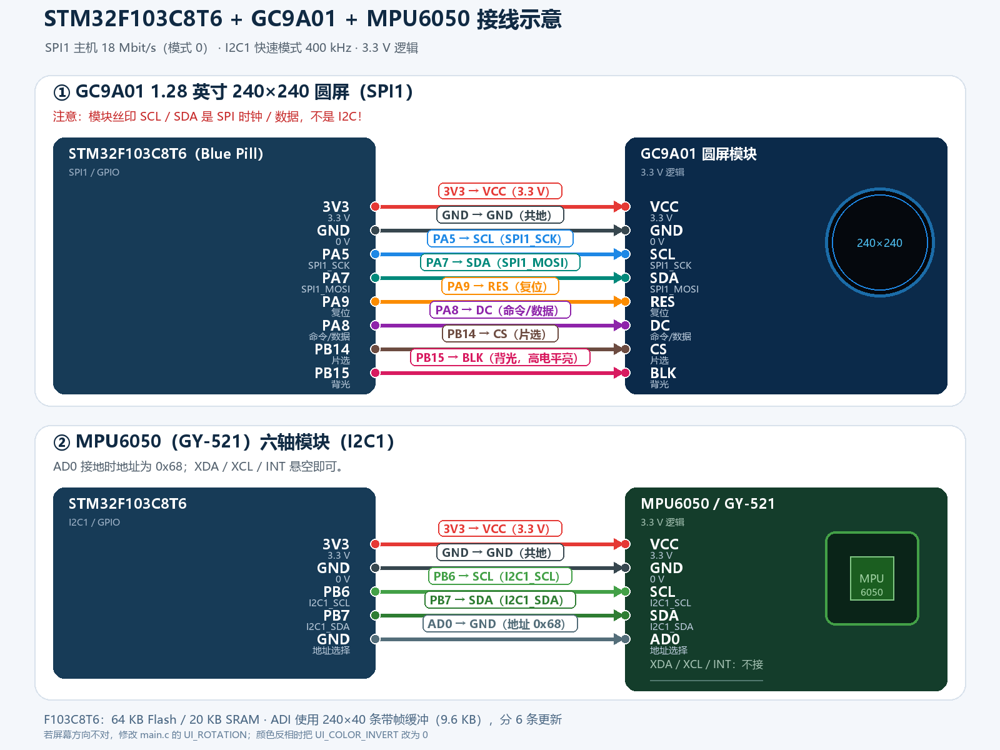
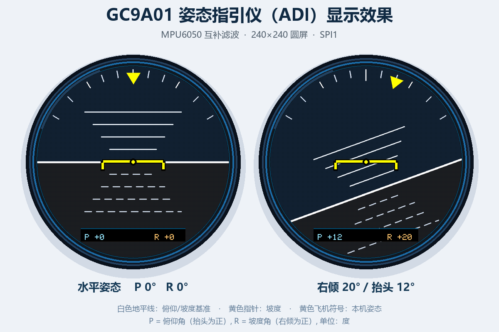

# STM32F103C8T6 + MPU6050 + GC9A01 圆形屏

在现有 CubeMX/Keil 工程 `F103 MPU6050 on OLED1315 2` 上移植：

- `STM32F103C8T6`（Blue Pill）通过 I2C1 读取 MPU6050；
- 使用你提供的 `MPU6050-master` 驱动读取加速度/角速度；
- 互补滤波计算俯仰角、坡度角；
- `GC9A01` 240×240 圆屏绘制飞机姿态指引仪（ADI）；
- 上电自动校准陀螺仪零偏；
- 传感器掉线时显示错误页并自动重试。

> F103C8T6 只有 20 KB SRAM，不能像 F407 版那样放 57.6 KB 全屏帧缓冲。本移植使用 **240×40 条带帧缓冲（9.6 KB）**，分 6 条合成并发送，既避免整屏闪白，又能放下。
>
> MPU6050 没有磁力计，所以只显示俯仰和坡度，不显示航向/偏航角。

## 1. 文件清单

| 文件 | 说明 |
|---|---|
| `Core/Inc/gc9a01.h` | GC9A01 驱动接口、颜色定义、条带 Blit |
| `Core/Src/gc9a01.c` | GC9A01 初始化、绘图、5×7 字体、8 位调色板发送 |
| `Core/Inc/mpu6050.h` | **你提供的 MPU6050 驱动头文件** |
| `Core/Src/mpu6050.c` | **你提供的 MPU6050 驱动源文件** |
| `Core/Src/main.c` | 应用层、姿态滤波、条带 ADI 绘图、错误处理 |
| `MDK-ARM/F103 MPU6050 on OLED1315 2.uvprojx` | 已加入 `gc9a01.c`、`mpu6050.c` |
| `WIRING_CN.png` | F103C8T6 接线示意图 |
| `DISPLAY_PREVIEW.png` | 水平/右倾两种姿态的 ADI 显示效果 |

`gc9a01.c` / `mpu6050.c` 已经加入 Keil 工程分组 `Application/User/Core`，`Core/Inc` 也已经在头文件搜索路径中，直接编译即可。

> 工程中的 `mpu6050.c` / `mpu6050.h` 与你提供的 `MPU6050-master` 文件保持一致，未修改驱动源码。

## 2. 接线



### 2.1 GC9A01（SPI1）

| STM32F103C8T6 | GC9A01 模块 | 说明 |
|---|---|---|
| 3.3 V | VCC | 3.3 V 供电 |
| GND | GND | 共地 |
| PA5 | SCL | SPI1_SCK，18 MHz |
| PA7 | SDA | SPI1_MOSI |
| PA8 | DC | 命令/数据选择 |
| PA9 | RES | 复位，低有效 |
| PB14 | CS | 片选，低有效 |
| PB15 | BLK | 背光，高电平点亮 |

> **重点：** GC9A01 模块上的 `SCL`、`SDA` 是 SPI 的时钟和数据，不是 I2C！不要接到 PB6/PB7。
>
> 如果模块的 BLK 直接接 3.3 V，背光会常亮，此时 PB15 可以不接。

### 2.2 MPU6050 / GY-521（I2C1）

| STM32F103C8T6 | MPU6050 模块 | 说明 |
|---|---|---|
| 3.3 V | VCC | 建议 3.3 V |
| GND | GND | 共地 |
| PB6 | SCL | I2C1_SCL，400 kHz |
| PB7 | SDA | I2C1_SDA |
| GND | AD0 | 地址 0x68 |
| — | INT | 不接 |
| — | XDA / XCL | 不接 |

> 你的驱动里地址固定为 `0xD0`（7 位地址 0x68），所以 AD0 必须接 GND。若 AD0 接 3.3 V，需要同时修改驱动中的 `MPU6050_ADDR` 和 `main.c` 的 `MPU6050_I2C_ADDRESS` 为 `0xD2`。
>
> GY-521 模块一般自带 4.7 kΩ I2C 上拉。若使用裸 MPU6050 芯片，需要在 SDA/SCL 上各加 4.7 kΩ 上拉到 3.3 V。
>
> 所有信号都是 3.3 V 逻辑，STM32、屏幕、MPU6050 必须共地。

## 3. CubeMX 配置

当前 `.ioc` 已经配置好：

- **SPI1**：Full-Duplex Master，8 bit，MSB First，Prescaler 4（APB2 72 MHz / 4 = 18 Mbit/s），CPOL Low，CPHA 1 Edge，NSS Software，CRC Disabled。
- **I2C1**：Fast Mode，400 kHz，7-bit。
- **GPIO**：PA8=DC、PA9=RES、PB14=CS、PB15=BLK，均为推挽输出，初始高电平。
- **时钟**：HSE 8 MHz，PLL ×9，SYSCLK 72 MHz，APB1 36 MHz，APB2 72 MHz。

如果重新用 CubeMX 生成工程，请确认上述配置没有变化；并且要把 `gc9a01.c`、`mpu6050.c` 重新加入 Keil 工程（CubeMX 重新生成 `.uvprojx` 时可能丢失自定义文件项）。

## 4. 姿态指引仪显示



屏幕界面仿照飞机姿态指引仪（Artificial Horizon / ADI）：

| 图形 | 含义 |
|---|---|
| 上半蓝色 / 下半棕色 | 天空 / 地面 |
| 白色中间线 | 地平线 |
| 地平线两侧短白线 | 俯仰梯，每格 5°，负俯仰为虚线 |
| 顶部弧形刻度 | 坡度刻度，范围 -60°~+60° |
| 顶部黄色三角 | 当前坡度指针 |
| 中央黄色飞机符号 | 本机固定基准 |
| 底部 `P` / `R` | 俯仰角 / 坡度角，整数度 |

右侧示意为右倾 20°、抬头 12° 时的画面：地平线向左下倾斜，天空/地面分界随姿态移动，黄色坡度指针指向右侧 20°。

### 4.1 姿态解算

MPU6050 的安装方向定义为：

- **+X → 右翼**
- **+Y → 机头**
- **+Z → 向上**

> 安装时让 MPU6050 芯片面朝上（Z 轴竖直向上），X/Y 轴按模块丝印方向摆放。  
> 如果模块和屏幕一起竖直安装，Z 轴会变成水平，静止时就会显示 90° 姿态；这时需要把模块转成水平安装，或修改 `Attitude_GetAccelAngles()` 里的轴映射。

程序调用你提供的驱动读取原始数据：

```c
MPU6050_Read_Accel(&hi2c1, &s_mpu);   // Accel_X_RAW / Y / Z
MPU6050_Read_Gyro(&hi2c1, &s_mpu);    // Gyro_X_RAW / Y / Z, Gx / Gy
```

再由加速度计算绝对姿态：

```text
roll  = atan2(-ax, sqrt(ay² + az²))
pitch = atan2( ay, az )
```

与陀螺仪积分做互补滤波：

```text
roll  = 0.96 * (roll  + gyro_y * dt) + 0.04 * roll_acc
pitch = 0.96 * (pitch + gyro_x * dt) + 0.04 * pitch_acc
```

> **为什么没有直接用驱动里的 KalmanAngleX/Y？**  
> 你的驱动内部使用 `double` 卡尔曼滤波，F103C8T6 没有 FPU，双精度运算开销较大；而且该 Kalman 的 `P` 矩阵初值为 0，启动收敛较慢。本移植保留你的驱动读取函数，但在 `main.c` 里使用轻量 `float` 互补滤波，启动就能得到正确姿态。  
> 如果你更想使用驱动自带的 Kalman，可以改为 `MPU6050_Read_All()` 并读取 `s_mpu.KalmanAngleX/Y`。

- 陀螺仪提供快速响应，加速度计负责长期修正零漂。
- 这是简化版姿态解算，适合正常飞行姿态（俯仰约 ±60°、坡度 ±60°），不做倒飞/全姿态四元数解算。
- 上电后先做约 0.7 秒陀螺仪零偏校准，屏幕显示 `CALIBRATING / KEEP STILL`，此时保持模块静止。
- 如果模块安装方向相反，屏幕上的坡度或俯仰方向会反，修改 `main.c` 中的 `ATT_ACC_ROLL_SIGN`、`ATT_ACC_PITCH_SIGN`、`ATT_GYRO_ROLL_SIGN`、`ATT_GYRO_PITCH_SIGN` 为 `-1.0f` 即可。
- 如果模块旋转了 90° 安装，需要交换 X/Y 轴，不能只靠正负号修正。

如果不想上电校准，把：

```c
#define MPU6050_AUTO_CALIBRATE 1
```

改成 `0`。

### 4.2 传感器错误页

如果 MPU6050 未接好，屏幕会显示：

```text
MPU6050
NO SENSOR
CHECK WIRING
SCL=PB6 SDA=PB7
AD0 -> GND
ERR CODE x
RETRYING...
```

错误码含义：

| 错误码 | 含义 |
|---|---|
| 2 | I2C 通信失败：检查 PB6/PB7、上拉、供电、共地 |
| 3 | WHO_AM_I 不是 0x68 / 初始化失败：检查 AD0、模块型号、地址 |

### 4.3 闪烁处理

早期版本直接在屏幕上先铺天空/地面、再画地平线和符号，刷新过程中会短暂看到“空背景”，因此闪烁明显。F103 只有 20 KB SRAM，不能放 57.6 KB 全屏缓冲，所以改为：

1. 在 SRAM 中建立 `240×40×8 bit` 的条带帧缓冲（9.6 KB）；
2. 每一条带内的天空、地面、地平线、俯仰梯、指针、飞机符号和读数全部合成好；
3. 调用 `GC9A01_Blit8Window()` 把这一条带发送到屏幕，再处理下一条；
4. 共 6 条，姿态变化小于 `0.15°` 时不重绘，静止时屏幕完全稳定；
5. SPI1 为 18 Mbit/s，整帧约 115 KB 数据，理论传输约 51 ms。

> 条带更新时仍可能出现水平扫描撕裂线（模块没有 TE 同步引脚），但不会再出现整屏“先变黑再重画”的闪白。静止时因为 0.15° 死区，屏幕完全不刷新。
>
> 如果 18 Mbit/s 下出现花屏/白屏（通常是杜邦线太长或接触不良），把 `spi.c` 中的分频改回 `SPI_BAUDRATEPRESCALER_8`（9 Mbit/s），并把 `.ioc` 里的 Prescaler 改回 8；此时画面仍然不会“闪白”，只是刷新稍慢。

## 5. 编译和下载

在 Keil 中打开：

```text
MDK-ARM\F103 MPU6050 on OLED1315 2.uvprojx
```

直接 `Rebuild` 即可。当前代码已经用 Keil MDK ARMCC V5.06 update 7 编译验证：

```text
0 Error(s), 0 Warning(s)
Program Size: Code=19382 RO-data=1518 RW-data=52 ZI-data=13596
```

生成的固件：

```text
MDK-ARM\F103 MPU6050 on OLED1315 2\F103 MPU6050 on OLED1315 2.hex
```

## 6. 可调参数

都在 `Core/Src/main.c` 的 `USER CODE BEGIN PD` 区域：

```c
#define ADI_REFRESH_MS         100U   // 显示刷新周期
#define SENSOR_RETRY_MS        1000U  // 传感器重试周期
#define MPU6050_AUTO_CALIBRATE 1      // 上电陀螺仪校准
#define UI_ROTATION            0U     // 屏幕方向 0~3
#define UI_COLOR_INVERT        1U     // 颜色反相 0/1
#define MPU6050_I2C_ADDRESS    0xD0U  // 7 位地址 0x68

#define ATT_ACC_ROLL_SIGN      1.0f   // 坡度方向
#define ATT_ACC_PITCH_SIGN     1.0f   // 俯仰方向
#define ATT_GYRO_ROLL_SIGN     1.0f   // 陀螺仪坡度方向
#define ATT_GYRO_PITCH_SIGN    1.0f   // 陀螺仪俯仰方向
#define ATT_FILTER_ALPHA       0.96f  // 互补滤波系数
#define ADI_PIXELS_PER_DEGREE  3.0f   // 每度俯仰对应的像素
```

- 屏幕方向不对：把 `UI_ROTATION` 依次改成 1、2、3 试。
- 颜色像负片：把 `UI_COLOR_INVERT` 改成 0。
- AD0 接 3.3 V：你的驱动里地址固定为 0xD0，需要把驱动中的 `MPU6050_ADDR` 和 `main.c` 的 `MPU6050_I2C_ADDRESS` 都改成 `0xD2`。
- 倾斜时地平线方向相反：把对应的 `ATT_*_SIGN` 改成 `-1.0f`。
- 俯仰变化幅度太小/太大：调整 `ADI_PIXELS_PER_DEGREE`（默认 3 像素/度）。
- 姿态响应太慢：减小 `ATT_FILTER_ALPHA`（例如 0.92）；漂移明显则增大到 0.98。
- 刷新太快/太慢：调整 `ADI_REFRESH_MS`。6 条带刷新 + SPI 传输需要时间，实际帧率会低于 `1000 / ADI_REFRESH_MS`。

## 7. 常见问题

### 屏幕不亮

1. 先确认 BLK 是否接对；可以把 BLK 直接接 3.3 V 测试背光。
2. 检查 3.3 V、GND、CS、DC、RES。
3. 检查 SPI1 是否是模式 0、8 bit、MSB First、软件 NSS。
4. 杜邦线较长时，把 SPI 分频改成 8（9 MHz）或 16（4.5 MHz）试试。

### 屏幕白屏 / 花屏

- 白屏通常是初始化命令没有成功发送：检查 SCL/MOSI/DC/RES/CS 是否接反。
- 花屏通常是 SPI 模式或位序不对：确认 CPOL=Low、CPHA=1 Edge、MSB First。
- 如果只显示一半或错位，确认买的是 240×240 GC9A01，不是 240×240 ST7789（两者初始化不同）。
- 21/18 MHz 下花屏也可能是杜邦线太长，降低 SPI 分频即可。

### 颜色反相

把 `UI_COLOR_INVERT` 改成 `0`。有些 GC9A01 模块需要 `0x21`，有些需要 `0x20`。

### MPU6050 读不到

- 用万用表确认 PB6/PB7 静态约 3.3 V（上拉正常）。
- 确认 AD0 接地；你的驱动地址固定为 0xD0。
- GY-521 的 VCC 建议 3.3 V；不要用 5 V 供电后再直接接 STM32 的 I2C（可能把总线拉到 5 V）。
- 可以临时写一个 I2C 扫描程序，确认能看到 0x68。

### 地平线方向反了

- 右倾时地平线倾斜方向相反：把 `ATT_ACC_ROLL_SIGN` 和 `ATT_GYRO_ROLL_SIGN` 同时改成 `-1.0f`。
- 抬头时地平线移动方向相反：把 `ATT_ACC_PITCH_SIGN` 和 `ATT_GYRO_PITCH_SIGN` 同时改成 `-1.0f`。
- 如果模块是横着/竖着安装的（X/Y 交换），只改符号不够，需要改 `Attitude_GetAccelAngles()` 里的轴映射。

### 姿态缓慢漂移 / 抖动

- 上电校准期间必须保持静止，否则零偏会被算进去。
- 陀螺仪本身有零漂，互补滤波会靠加速度计慢慢修正；短时间轻微漂移正常。
- 抖动明显时，可把 `ATT_FILTER_ALPHA` 增大到 `0.98`，或给 MPU6050 增加减震。
- 如果倾斜时响应明显滞后，可把 `ATT_FILTER_ALPHA` 减小到 `0.92`。
- 快速平移模块时，加速度计会混入线性加速度，姿态会短暂偏差，这是加速度计方案的固有限制。

### 画面内容稳定但整体亮度在抖

- 这通常不是绘图代码，而是 3.3 V 供电/地线压降或背光电流波动。
- 用短而粗的 GND 线，屏幕 VCC 直接接到稳压 3.3 V；不要用 ST-Link 的 3.3 V 同时带屏幕和背光。
- 背光 BLK 可以试直接接 3.3 V（常亮），排除 PB15 控制带来的干扰。

## 8. 驱动接口

### GC9A01

```c
uint8_t GC9A01_Init(SPI_HandleTypeDef *hspi);
void GC9A01_SetRotation(uint8_t rotation);      // 0..3
void GC9A01_SetInversion(uint8_t enable);
void GC9A01_SetBacklight(uint8_t on);
void GC9A01_FillScreen(uint16_t color);
void GC9A01_FillRect(int16_t x, int16_t y, int16_t w, int16_t h, uint16_t color);
void GC9A01_DrawPixel(int16_t x, int16_t y, uint16_t color);
void GC9A01_DrawLine(int16_t x0, int16_t y0, int16_t x1, int16_t y1, uint16_t color);
void GC9A01_DrawRect(int16_t x, int16_t y, int16_t w, int16_t h, uint16_t color);
void GC9A01_DrawCircle(int16_t x0, int16_t y0, int16_t r, uint16_t color);
void GC9A01_FillCircle(int16_t x0, int16_t y0, int16_t r, uint16_t color);
void GC9A01_DrawString(int16_t x, int16_t y, const char *str,
                       uint16_t fg, uint16_t bg, uint8_t scale);
void GC9A01_DrawStringCentered(int16_t y, const char *str,
                               uint16_t fg, uint16_t bg, uint8_t scale);
void GC9A01_DrawStringTransparent(int16_t x, int16_t y, const char *str,
                                  uint16_t fg, uint8_t scale);
void GC9A01_Blit8(const uint8_t *framebuffer, const uint16_t *palette,
                  uint16_t width, uint16_t height);
void GC9A01_Blit8Window(const uint8_t *framebuffer, const uint16_t *palette,
                        uint16_t width, uint16_t height,
                        uint16_t x, uint16_t y);
void GC9A01_DrawStringToBuffer(uint8_t *buffer, uint16_t buffer_width,
                               uint16_t buffer_height, int16_t x, int16_t y,
                               const char *str, uint8_t fg, uint8_t bg,
                               uint8_t scale);
```

颜色是 RGB565，例如：

```c
uint16_t orange = GC9A01_Color565(255, 120, 0);
GC9A01_DrawStringCentered(100, "HELLO", GC9A01_WHITE, GC9A01_BLACK, 2);
```

字体为 5×7 点阵，支持 ASCII 0x20~0x7E，`scale` 支持 1~4。

### MPU6050（你的驱动）

```c
uint8_t MPU6050_Init(I2C_HandleTypeDef *I2Cx);
void MPU6050_Read_Accel(I2C_HandleTypeDef *I2Cx, MPU6050_t *DataStruct);
void MPU6050_Read_Gyro(I2C_HandleTypeDef *I2Cx, MPU6050_t *DataStruct);
void MPU6050_Read_Temp(I2C_HandleTypeDef *I2Cx, MPU6050_t *DataStruct);
void MPU6050_Read_All(I2C_HandleTypeDef *I2Cx, MPU6050_t *DataStruct);
double Kalman_getAngle(Kalman_t *Kalman, double newAngle, double newRate, double dt);
```

本移植实际调用：

```c
MPU6050_Read_Accel(&hi2c1, &s_mpu);
MPU6050_Read_Gyro(&hi2c1, &s_mpu);
```

使用的原始数据字段：

```c
s_mpu.Accel_X_RAW / Y / Z
s_mpu.Gyro_X_RAW / Y / Z
s_mpu.Gx / Gy / Gz          // dps，±250 dps 量程
s_mpu.Temperature           // °C
```

驱动初始化配置为：

- 加速度 ±2 g，16384 LSB/g
- 陀螺仪 ±250 dps，131 LSB/dps
- 采样率 125 Hz（`SMPLRT_DIV = 0x07`）
- 地址固定为 `0xD0`

`MPU6050_Read_All()` 还会运行驱动内部的 `double` Kalman，并给出 `KalmanAngleX/Y`；如果要使用它，直接把主循环改成调用 `MPU6050_Read_All()` 即可。

## 9. 参考资料

- MPU6050 驱动（Bulanov Konstantin / leech001）：  
  <https://github.com/leech001/MPU6050>
- GC9A01 初始化序列参考 QMK Quantum Painter 的公开实现：  
  <https://codeberg.org/Gwarnifarn/nuphy_qmk_firmware/commit/1f2b1dedccdf21b629c45ece80b4ca32f6653296>
- 5×7 点阵字体来自经典 Adafruit GFX 字体：  
  <https://github.com/adafruit/Adafruit-GFX-Library>
- GC9A01 控制器资料与 Adafruit 驱动说明：  
  <https://adafruit.github.io/Adafruit_GC9A01A/html/class_adafruit___g_c9_a01_a.html>
